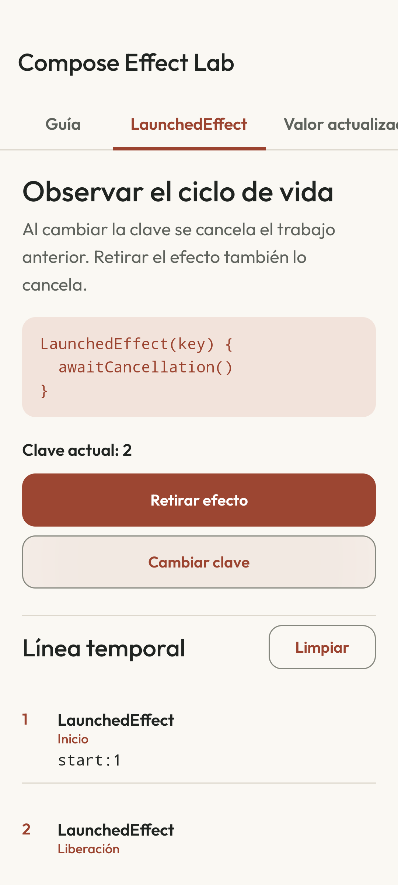

# Compose Effect Lab

[English](README.md) · [](https://github.com/navalcode/compose-effect-lab/actions/workflows/checks.yml)

Proyecto Android didáctico para comprender y aplicar correctamente
`LaunchedEffect`, `DisposableEffect` y `rememberUpdatedState` en Jetpack Compose.
Los ejemplos son ficticios, autocontenidos y no incluyen código ni datos
propietarios.

La dinámica es **predecir, ejecutar, observar y explicar**. Cada laboratorio
muestra una línea temporal para hacer visible cuándo comienza un efecto, cuándo
se reinicia, cuándo se cancela y cuándo libera un recurso.

## Pantalla y comportamiento



La pantalla usa Outfit local, paleta papel/tinta/cobre y filas abiertas para las trazas. Los textos del producto tienen recursos españoles y fallback inglés. Cada experimento posee sus efectos fuera de las filas lazy: desplazar el resultado no cancela ni reinicia el trabajo. El ejemplo de valor actualizado tiene su propia pestaña y permite repetir entregas. [Decisiones de diseño y accesibilidad](DESIGN.md) · [Aviso de la fuente](THIRD_PARTY.md).


## Qué cubre

| Hito | Evidencia |
|---|---|
| Comprender `LaunchedEffect` | Demo con clave, salida de composición y cancelación |
| Comprender `DisposableEffect` | Registro y liberación de listeners simulados |
| Elegir claves correctas | Cambio interactivo de identidad y línea temporal |
| Evitar reinicios innecesarios | Demo con `rememberUpdatedState` |
| Aplicar efectos a casos prácticos | Analítica temporizada y `LifecycleObserver` |
| Demostrar el comportamiento | Tests unitarios e instrumentados de Compose |

## Ejecutar

1. Abrir este directorio con Android Studio (JDK 17, Android SDK 36).
2. Esperar a que finalice la sincronización de Gradle.
3. Seleccionar un emulador o dispositivo con Android 8 / API 26 o superior.
4. Ejecutar la configuración `app`.

Validación por terminal:

```bash
./gradlew testDebugUnitTest assembleDebug
./gradlew connectedDebugAndroidTest
```

El segundo comando requiere un dispositivo o emulador conectado.

## Ruta recomendada

1. Leer `docs/01_GUIA_DIDACTICA.md`.
2. Insertar `LaunchedEffect`, cambiar su clave y retirarlo de composición.
3. Probar `rememberUpdatedState` cambiando el mensaje durante la espera.
4. Registrar un listener con `DisposableEffect`, cambiar su clave y liberarlo.
5. Revisar la tabla de `docs/02_COMPARATIVA.md`.
6. Ejecutar los dos casos reales y resolver `docs/03_EJERCICIOS.md`.

## Arquitectura

```text
Compose UI ──claves/presencia──> Effects
    │                               │
    ├── línea temporal <────────────┤
    │                               ├── coroutine suspendible
    │                               └── recurso registrable
    └── clases puras testeables: recorder + fake registry
```

## Referencia oficial

- [Side-effects in Compose](https://developer.android.com/develop/ui/compose/side-effects)


## Alcance de validación

Cuatro tests JVM, lint y build debug correctos localmente con JDK 17. Lint informa cero errores y un aviso de versión objetivo. Nueve tests instrumentados pasan en emulador API 37 a 360 × 800 dp y texto 150%: cuatro contratos de probes, cuatro recorridos de pantalla y uno de MainActivity real. Hay recorridos/capturas adicionales EN/ES de MainActivity a texto 100%. El test de entrada real usa las API de idioma por app de 33+; no se atribuye una prueba de dispositivo de API inferior.

La regresión de scroll observó primero dos arranques de la misma clave con texto grande en el diseño original de filas lazy. La pantalla corregida conserva un arranque hasta cambiar la clave/presencia. Los otros recorridos comprueban reemplazo/retirada, entrega del valor actualizado sin reiniciar, repetición de entregas y liberación del listener al salir de su pantalla.

La CI existente ejecuta tests JVM, lint y build debug. Los recorridos nativos anteriores se ejecutaron localmente; el badge correcto no significa que hayan corrido remotamente. El APK debug tiene bibliotecas y entradas ZIP alineadas, sin metadatos R8. No acredita release optimizada, dispositivo físico o distribución en tienda.
