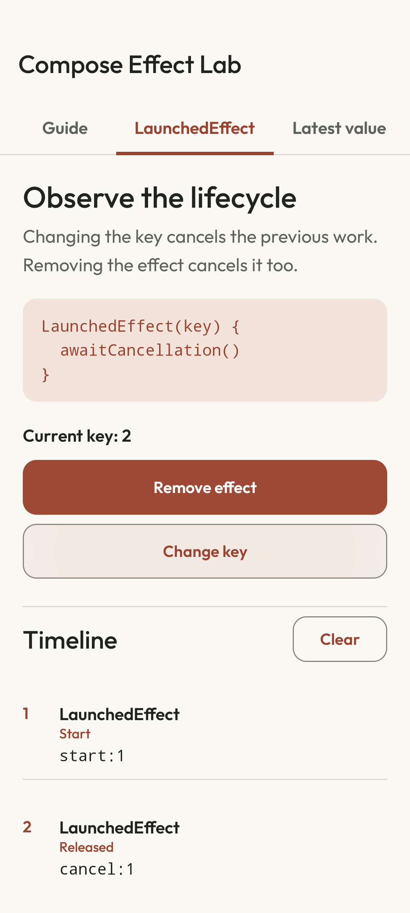

# Compose Effect Lab

[Español](README.es.md) · [CI](https://github.com/navalcode/compose-effect-lab/actions/workflows/checks.yml)

An Android app for comparing LaunchedEffect, DisposableEffect and rememberUpdatedState. Change keys and composition presence, then read the start, cancellation and cleanup events. The examples run locally without an analytics service.



## Try it

1. Open **LaunchedEffect**, insert the effect, change its key and remove it. Compare `start` and `cancel` events.
2. Open **Latest value**, start the three-second delivery and change the message during the wait. The latest value is delivered without restarting the effect. You can repeat delivery.
3. Register a listener in **DisposableEffect**. Change its resource key and release it. GPS, Lifecycle and Sensor are names of simulated resources; no location or sensor data is read.
4. In **Cases**, keep the same screen ID in composition for two seconds to record a fictional event. Changing the ID cancels the earlier wait. The lifecycle observer uses the actual LifecycleOwner and is removed when its example leaves composition.

Scrolling does not remove an experiment from composition. Changing its key, removing it or leaving its tab still cancels/releases its work. Event log clearing only removes recorded events.

## Build and run

Use JDK 17, Android SDK 36 and API 26+ for installation. Open the project in Android Studio or configure the SDK in an untracked `local.properties`. From this directory:

```sh
./gradlew :app:testDebugUnitTest :app:lintDebug :app:assembleDebug
./gradlew :app:installDebug
```

The Gradle 8.13 wrapper verifies its distribution SHA-256. Dependencies are pinned in `gradle/libs.versions.toml`. Native test locale rules require API 33+; replace `DEVICE_ID` with an explicit serial:

```sh
ANDROID_SERIAL=DEVICE_ID ./gradlew :app:connectedDebugAndroidTest
```

## Read the code

- [EffectDemos.kt](app/src/main/java/com/example/composeeffectlab/ui/EffectDemos.kt): keyed coroutine, listener lifetime and latest callback probes.
- [ComposeEffectLabApp.kt](app/src/main/java/com/example/composeeffectlab/ui/ComposeEffectLabApp.kt): controls, effect ownership outside lazy cells and the two practical cases.
- [FakeListenerRegistry.kt](app/src/main/java/com/example/composeeffectlab/domain/FakeListenerRegistry.kt): simulated registration handles.
- [EffectEventRecorder.kt](app/src/main/java/com/example/composeeffectlab/model/EffectEventRecorder.kt): ordered event snapshots.
- [EffectScreenTest.kt](app/src/androidTest/java/com/example/composeeffectlab/ui/EffectScreenTest.kt): scrolling, replacement, repeated delivery and listener release.

Pure JVM tests cover the recorder/registry. Instrumented Compose tests inspect lifecycle behavior; the real-entry test launches MainActivity separately from screen probes. Raw API/probe messages remain stable so they can be matched to code.

Detailed Spanish guides:

- [Guide to effect lifecycle](docs/01_GUIA_DIDACTICA.md)
- [Effect comparison](docs/02_COMPARATIVA.md)
- [Exercises](docs/03_EJERCICIOS.md)
- [Session outline](docs/04_MATERIAL_PARA_COMPARTIR.md)

## Checks and limits

The suite contains **4 JVM tests and 9 native tests**. [Verification](docs/VERIFICATION.md) records dated runs, screenshots, audit warnings and the difference between local native coverage and hosted CI. [DESIGN.md](DESIGN.md) explains the interface.

Spanish resources have an English fallback. No physical-device, formal accessibility, optimized-release or store result is claimed. Existing licenses and font/dependency attribution remain in [third-party notices](THIRD_PARTY.md).
